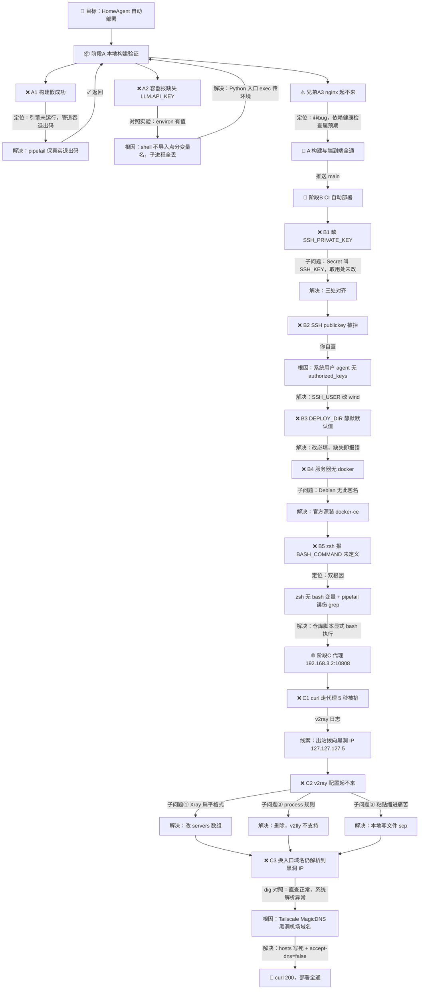

# 首次自动部署踩坑记录（2026-10-11）

从编写 docker-compose / GitHub Actions 到首次部署成功全过程中的问题树：
每个分支记录「现象 → 定位 → 根因 → 解决 → 返回/进入下一个问题」的完整链路。

## 图例

- 边标注 = 排查过程：「发现 → 定位 → 解决 → 返回父问题 / 进入下一个兄弟问题」
- B2 → B3 → B4 → B5 的推进，正是「修复一个、重跑流水线、撞出下一个」的真实序列
- 三条最值得记住的教训：
  1. **shell 会静默丢弃点分环境变量**——容器入口必须用 Python exec 形式（`deploy/entrypoint.py`）
  2. **管道会吞退出码**——一切自动化脚本加 `set -Eeuo pipefail`，绝不静默继续
  3. **Tailscale MagicDNS 会接管系统 DNS**——排查解析问题时先看 `/etc/resolv.conf` 是不是被谁改了
