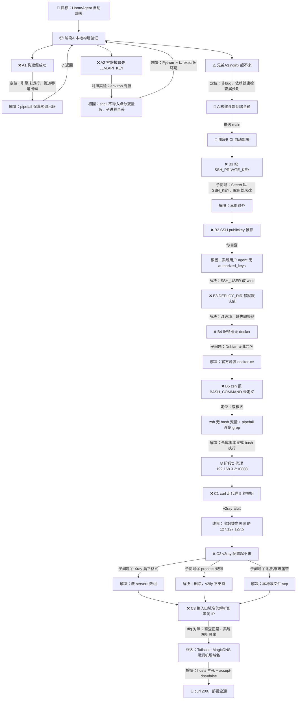
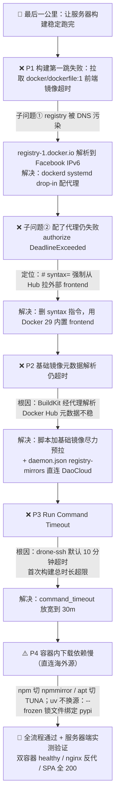

# 首次自动部署踩坑记录（2026-10-11）

从编写 docker-compose / GitHub Actions 到首次部署成功全过程中的问题树：
每个分支记录「现象 → 定位 → 根因 → 解决 → 返回/进入下一个问题」的完整链路。

## 图例

- 边标注 = 排查过程：「发现 → 定位 → 解决 → 返回父问题 / 进入下一个兄弟问题」
- B2 → B3 → B4 → B5 的推进，正是「修复一个、重跑流水线、撞出下一个」的真实序列
- 三条最值得记住的教训：
  1. **shell 会静默丢弃点分环境变量**——容器入口必须用 Python exec 形式（`deploy/entrypoint.py`）
  2. **管道会吞退出码**——一切自动化脚本加 `set -Eeuo pipefail`，绝不静默继续
  3. **Tailscale MagicDNS 会接管系统 DNS**——排查解析问题时先看 `/etc/resolv.conf` 是不是被谁改了

---

## 下半场问题树：服务器构建收敛（同日晚）

上半场部署成功后，服务器端构建暴露出一串「每修一个、重跑、撞出下一个」的问题——
共同主题：**构建的每一个外网依赖（frontend 解析镜像、基础镜像、容器内包管理）都是独立卡点**。

### 下半场教训

4. **构建的外网依赖要逐层消除**：`# syntax=` frontend 镜像、基础镜像、容器内的 npm/pypi/apt 是三层独立的卡点，每层都要么有镜像源、要么有缓存兜底
5. **drone-ssh 默认 `command_timeout` 只有 10 分钟**——远程脚本做完整构建时必改
6. **uv `--frozen` 锁文件绑定了 registry URL**——换镜像源会导致锁校验失败，不能想当然地把 pip 换源经验照搬过去
7. **部署机不需要 node/npm**——前端构建全部发生在构建镜像内部；在宿主机 `apt install npm` 是徒劳的

